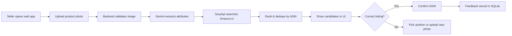
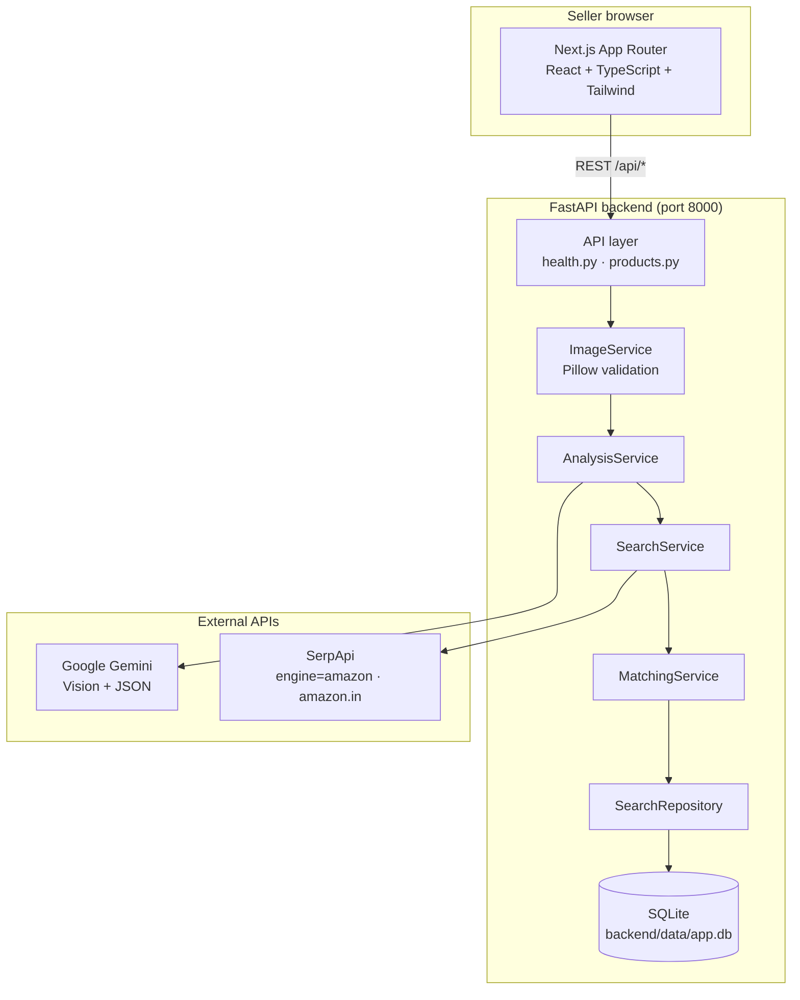
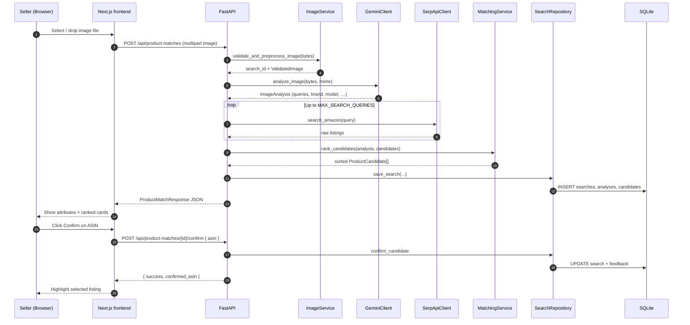
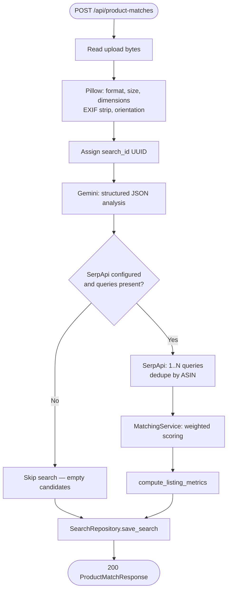
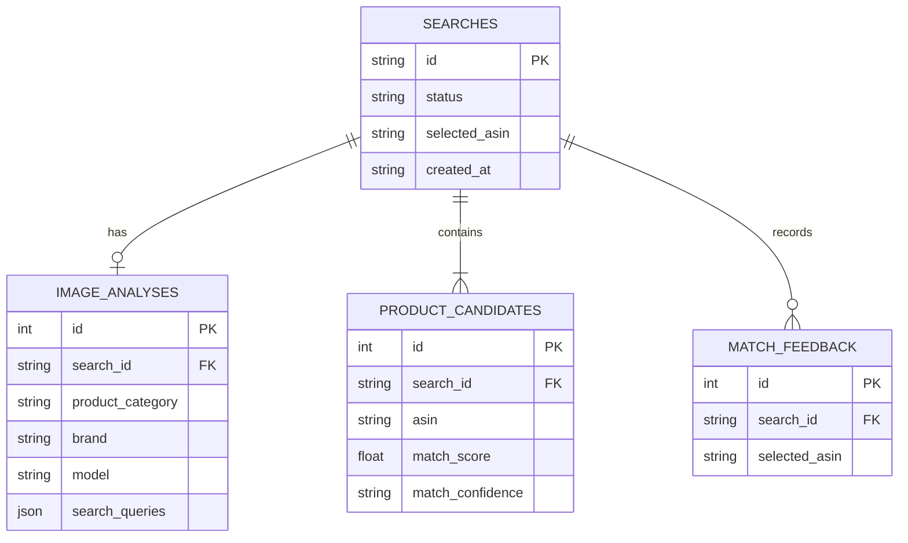

# Image-to-Amazon.in Product Matching Platform

A full-stack web application that helps marketplace sellers turn a **product photograph** into **ranked Amazon India (Amazon.in) listings**. The system uses **Google Gemini** for vision-based attribute extraction, **SerpApi** for Amazon.in search results, and a **deterministic ranking engine** so match scores stay explainable. Sellers review candidates, confirm the correct ASIN, and see price and listing metadata when the provider returns it.

---

## Table of Contents

1. [What This Project Does](#what-this-project-does)
2. [End-to-End User Workflow](#end-to-end-user-workflow)
3. [System Architecture](#system-architecture)
4. [Request Flow (Upload to Confirmation)](#request-flow-upload-to-confirmation)
5. [Components and Services](#components-and-services)
6. [Repository Layout](#repository-layout)
7. [Prerequisites](#prerequisites)
8. [Environment Configuration](#environment-configuration)
9. [Setup and Run (Local Development)](#setup-and-run-local-development)
10. [API Reference](#api-reference)
11. [Data Model and Persistence](#data-model-and-persistence)
12. [Candidate Ranking](#candidate-ranking)
13. [Testing and Smoke Tests](#testing-and-smoke-tests)
14. [Error Handling](#error-handling)
15. [Security and Privacy](#security-and-privacy)
16. [Known Limitations](#known-limitations)
17. [Further Documentation](#further-documentation)

---

## What This Project Does

| Goal | How the platform addresses it |
|------|-------------------------------|
| Match a photo to Amazon.in ASINs | Gemini extracts brand, model, category, and visible text; SerpApi searches Amazon.in with generated queries |
| Reduce variant confusion | Ranking compares attributes and applies penalties for contradictions (e.g. model mismatch) |
| Transparent decisions | Each candidate shows match score, confidence band, and signal breakdown—not opaque ML probabilities |
| Traceable marketplace data | ASIN, title, URL, price (when present), and `retrieved_at` timestamps come from validated API responses |
| Audit trail | SQLite stores searches, analysis, candidates, and seller confirmations |

**Out of scope for this prototype:** Google Lens, direct Amazon scraping, multi-marketplace support, authentication, background job queues, and guaranteed seller/offer counts from search snippets.

---

## End-to-End User Workflow

1. Open the Next.js app at `http://localhost:3000`.
2. The UI checks backend health and whether Gemini / SerpApi keys are configured.
3. Upload one product image (JPEG, PNG, or WebP, up to 10 MB).
4. Wait while the backend validates the image, calls Gemini, searches Amazon.in, ranks results, and saves the session.
5. Review extracted attributes and the ranked candidate list (sorted by match score).
6. Open listing links on Amazon.in, compare variants, and **Confirm** the correct ASIN.
7. Optionally retrieve past searches via `GET /api/product-matches` (API; history UI is not yet a dedicated page).



---

## System Architecture

The application is a **modular monolith**: one FastAPI process orchestrates all server-side logic. The browser **never** calls Gemini or SerpApi; API keys stay on the backend.



### Technology stack

| Layer | Stack | Role |
|-------|--------|------|
| Frontend | Next.js 16, React 19, TypeScript, Tailwind CSS 4 | Upload UI, analysis display, candidate cards, confirmation |
| Backend | Python 3.12+, FastAPI, Pydantic v2, Uvicorn | REST API, orchestration, validation, ranking |
| Images | Pillow | Signature checks, EXIF strip, orientation, size limits |
| Vision AI | `google-genai` → configurable model (default `gemini-3.8-flash`) | Structured attribute extraction |
| Marketplace | HTTPX → SerpApi Amazon Search | Amazon.in organic results |
| Persistence | SQLAlchemy + SQLite | Searches, analysis, candidates, feedback |

---

## Request Flow (Upload to Confirmation)

### Sequence diagram (happy path)



### Processing pipeline (backend)



---

## Components and Services

### Frontend (`frontend/`)

| Piece | Path | Responsibility |
|-------|------|----------------|
| Home page | `src/app/page.tsx` | Health banner, upload/results layout, confirmation handler |
| API client | `src/lib/api.ts` | Typed calls to backend; maps `NEXT_PUBLIC_BACKEND_URL` |
| ImageUploader | `src/components/ImageUploader.tsx` | Drag-and-drop, client pre-checks (10 MB, MIME), `POST` multipart |
| AnalysisStatus | `src/components/AnalysisStatus.tsx` | Category, brand, model, visible text, queries, uncertainties |
| CandidateList / CandidateCard | `src/components/CandidateList.tsx`, `CandidateCard.tsx` | Ranked listings, scores, Amazon links, confirm action |

The frontend only talks to **your FastAPI backend**. It does not embed Gemini or SerpApi keys.

### Backend API layer (`backend/app/api/`)

| Endpoint | Handler | Purpose |
|----------|---------|---------|
| `GET /api/health` | `health.py` | Liveness + flags for Gemini/SerpApi key presence (no secret leakage) |
| `POST /api/product-matches` | `products.py` | Full match pipeline (sync for MVP) |
| `GET /api/product-matches` | `products.py` | Paginated search history |
| `GET /api/product-matches/{search_id}` | `products.py` | Reload a stored session |
| `POST /api/product-matches/{search_id}/confirm` | `products.py` | Persist seller’s chosen ASIN |

Global exception handlers in `main.py` normalize `AppError`, validation errors, and unexpected failures into `{ "error": { "code", "message", "details" } }`.

### ImageService (`backend/app/services/image_service.py`)

- Generates a **`search_id`** (UUID) per upload.
- Delegates to `utils/image_validation.py`:
  - Accept **JPEG, PNG, WebP** using binary signatures (not filename alone).
  - Enforce **max upload size** (`MAX_UPLOAD_SIZE_MB`, default 10).
  - Cap dimensions, normalize orientation, strip unnecessary EXIF.
- Returns a **`ValidatedImage`** buffer passed to Gemini (images are processed in memory; not stored permanently by default).

### AnalysisService + GeminiClient (`analysis_service.py`, `integrations/gemini_client.py`)

- Sends the validated image to Gemini with a strict JSON schema prompt (no hallucinated brands/models).
- Parses and validates **`ImageAnalysis`**: category, brand, model, color, visible text, identifying attributes, uncertainties, and up to **3 search queries**.
- Uses configurable **`GEMINI_MODEL`** and **`GEMINI_TIMEOUT_SECONDS`** (vision calls can take 30–90+ seconds).
- Retries once on malformed JSON when appropriate; otherwise raises **`ExternalProviderError`**.

### SearchService + SerpApiClient (`search_service.py`, `integrations/serpapi_client.py`)

- Runs up to **`MAX_SEARCH_QUERIES`** distinct queries (default 3 in code config, 2 in root `.env.example`).
- Calls SerpApi with **`engine=amazon`** and **`amazon_domain=amazon.in`**.
- Normalizes each organic hit to **`ProductCandidate`**: ASIN, title, URL, thumbnail, price, currency.
- **Deduplicates by ASIN** across queries.
- **`seller_count`** is left **`null`** when SerpApi search snippets do not provide it (see [Known Limitations](#known-limitations)).

### MatchingService (`backend/app/services/matching_service.py`)

- Compares Gemini **`ImageAnalysis`** to each candidate title/metadata.
- **Weights (ADR-005):** Brand 25%, Model 30%, Category 15%, Variant 20%, Other 10%.
- Missing attributes are **neutral**, not automatic mismatches.
- Verified conflicts apply a **contradiction penalty** (×0.40 multiplier on score).
- **Confidence bands:** `high` ≥ 0.85, `medium` ≥ 0.60, else `low`.
- Sorts candidates by **`match_score`** descending (deterministic).

### SearchRepository + database (`repositories/search_repository.py`, `models/search.py`)

- **`SearchModel`**: session id, status, selected ASIN, timestamps.
- **`ImageAnalysisModel`**: one row per search with JSON arrays for text/attributes/queries.
- **`ProductCandidateModel`**: many rows per search; unique `(search_id, asin)`.
- **`MatchFeedbackModel`**: records confirmation events.
- Schema is created on startup via `init_db()` in the FastAPI lifespan hook.

### Utilities

- **`marketplace_metrics.py`**: Sets `total_candidates` / `total_sellers` on the API response as **counts of unique ASINs** in the candidate pool (not Amazon Buy Box seller counts).
- **`logging.py`**: Structured logs without API keys or raw image bytes.

---

## Repository Layout

```
.
├── README.md                 # This file
├── AGENTS.md                 # Living context for contributors and AI agents
├── architecture.md           # Authoritative architecture specification
├── implementationPlan.md     # Phased delivery plan
├── .env.example              # Root environment template
├── docs/
│   ├── IMPLEMENTATION_STATUS.md
│   └── PRICE_AND_SELLER_COUNT_VALIDATION.md
├── data/                     # Sample images for manual testing
├── scripts/
│   └── smoke_test.py         # Live E2E check against running backend
├── backend/
│   ├── requirements.txt
│   ├── pyproject.toml
│   ├── .env                  # Backend secrets (not committed)
│   ├── data/app.db           # SQLite file (local dev)
│   ├── app/
│   │   ├── main.py           # FastAPI app, CORS, exception handlers
│   │   ├── config.py         # Settings from .env
│   │   ├── api/              # Route modules
│   │   ├── services/         # Domain orchestration
│   │   ├── integrations/     # Gemini & SerpApi adapters
│   │   ├── repositories/     # Persistence
│   │   ├── models/           # SQLAlchemy models
│   │   ├── schemas/          # Pydantic API models
│   │   └── utils/            # Validation, scoring helpers, metrics
│   └── tests/                # pytest suite (mocked external APIs)
└── frontend/
    ├── package.json
    ├── .env.local            # NEXT_PUBLIC_BACKEND_URL
    └── src/
        ├── app/              # Next.js pages & layout
        ├── components/       # UI building blocks
        ├── lib/api.ts        # Backend client
        └── types/product.ts  # Shared TS types
```

---

## Prerequisites

| Requirement | Notes |
|-------------|--------|
| **Python 3.12+** | Tested on 3.13.x |
| **Node.js 20+** | Next.js 16; npm 10+ |
| **Gemini API key** | [Google AI Studio](https://aistudio.google.com/) |
| **SerpApi API key** | [SerpApi](https://serpapi.com/) |

---

## Environment Configuration

Settings are loaded from **`backend/.env`** and **`.env`** at the repo root (see `backend/app/config.py`). Use the same keys in both places if you keep split env files.

### Root `.env` (copy from `.env.example`)

```bash
copy .env.example .env
```

| Variable | Description |
|----------|-------------|
| `APP_ENV` | `development` / `testing` / `production` |
| `GEMINI_API_KEY` | Google Gemini API key |
| `GEMINI_MODEL` | Default `gemini-3.8-flash` |
| `GEMINI_TIMEOUT_SECONDS` | Default `120` (do not set below ~60 for vision) |
| `SERPAPI_API_KEY` | SerpApi key |
| `DATABASE_URL` | Default `sqlite:///./data/app.db` (relative to backend cwd) |
| `MAX_UPLOAD_SIZE_MB` | Default `10` |
| `MAX_SEARCH_QUERIES` | Cap on Gemini queries sent to SerpApi |
| `MAX_CANDIDATES_PER_QUERY` | SerpApi result cap per query |
| `CORS_ORIGINS` | Comma-separated; include `http://localhost:3000` |
| `NEXT_PUBLIC_BACKEND_URL` | Used by Next.js when building/running frontend |

### Backend `backend/.env`

Mirror **`GEMINI_API_KEY`**, **`SERPAPI_API_KEY`**, and **`DATABASE_URL`** here so Uvicorn picks them up when started from `backend/`.

### Frontend `frontend/.env.local`

```env
NEXT_PUBLIC_BACKEND_URL=http://localhost:8000
```

---

## Setup and Run (Local Development)

Run **backend** and **frontend** in two terminals.

### 1. Backend

```powershell
cd backend
python -m venv .venv
.venv\Scripts\activate
pip install -r requirements.txt
pip install sqlalchemy
```

> **Note:** Persistence uses SQLAlchemy. If `pip install -r requirements.txt` alone misses it, install `sqlalchemy` explicitly as above.

Create or edit `backend/.env` with your API keys, then:

```powershell
uvicorn app.main:app --reload --host 127.0.0.1 --port 8000
```

| URL | Purpose |
|-----|---------|
| http://localhost:8000 | API root |
| http://localhost:8000/api/health | Health + integration readiness |
| http://localhost:8000/docs | Swagger UI |

### 2. Frontend

```powershell
cd frontend
npm install
npm run dev
```

Open **http://localhost:3000**. The status banner should show **Connected & Operational** when the backend is up and keys are set.

### 3. Optional: live smoke test

With the backend running:

```powershell
cd ..
python scripts/smoke_test.py --base-url http://127.0.0.1:8000
```

The script synthesizes a sample product image, uploads it, and prints analysis plus discovered candidates.

### Production-style frontend build

```powershell
cd frontend
npm run build
npm run start
```

---

## API Reference

### `GET /api/health`

```json
{
  "status": "ok",
  "environment": "development",
  "gemini_configured": true,
  "serpapi_configured": true
}
```

### `POST /api/product-matches`

- **Content-Type:** `multipart/form-data`
- **Field:** `image` (required)

**Example (curl):**

```bash
curl -X POST "http://localhost:8000/api/product-matches" \
  -F "image=@./data/test_sample.png"
```

**Response (shape):**

```json
{
  "search_id": "uuid",
  "status": "completed",
  "analysis": {
    "product_category": "...",
    "brand": "...",
    "model": "...",
    "search_queries": ["...", "..."]
  },
  "candidates": [
    {
      "asin": "B0XXXXXXXX",
      "title": "...",
      "product_url": "https://www.amazon.in/dp/B0XXXXXXXX",
      "price_amount": 1499.0,
      "currency": "INR",
      "seller_count": null,
      "match_score": 0.87,
      "match_confidence": "high",
      "retrieved_at": "2026-10-15T12:00:00+00:00"
    }
  ],
  "total_candidates": 9,
  "total_sellers": 9,
  "selected_asin": null
}
```

### `GET /api/product-matches?limit=20&offset=0`

Returns an array of **`ProductMatchResponse`** objects, newest first.

### `GET /api/product-matches/{search_id}`

Returns one stored session or **404** `NOT_FOUND`.

### `POST /api/product-matches/{search_id}/confirm`

```json
{ "asin": "B0XXXXXXXX" }
```

Response: `{ "success": true, "confirmed_asin": "B0XXXXXXXX" }`.

---

## Data Model and Persistence



SQLite file path follows **`DATABASE_URL`**. When running Uvicorn from `backend/`, the default file is **`backend/data/app.db`**.

---

## Candidate Ranking

| Signal | Weight | Notes |
|--------|--------|--------|
| Brand | 25% | Token overlap between analysis and listing title |
| Model / model number | 30% | Strong weight; conflicts heavily penalized |
| Category | 15% | Semantic overlap on category strings |
| Variant (color, size, pack) | 20% | Reduces wrong-variant suggestions |
| Other descriptive tokens | 10% | Visible text and identifying attributes |

**Confidence thresholds (provisional):**

- **High:** score ≥ 0.85 and no critical contradiction  
- **Medium:** 0.60 – 0.84  
- **Low:** &lt; 0.60  

Scores are **ranking heuristics**, not calibrated probabilities. Sellers should always confirm the final ASIN.

---

## Testing and Smoke Tests

### Backend (pytest, mocked providers)

```powershell
cd backend
pytest
```

Tests cover image validation, Gemini response parsing, SerpApi normalization, matching logic, marketplace metrics, persistence, health, and configuration—**without requiring live API keys** in CI-style runs.

### Frontend

```powershell
cd frontend
npm run lint
npm run build
```

### Manual checklist

1. `GET /api/health` returns `ok` with both integrations configured.  
2. Upload a clear product photo with visible brand/model text.  
3. Verify candidates link to `amazon.in` and prices show or display as unavailable.  
4. Confirm an ASIN and reload `GET /api/product-matches/{search_id}` to see `selected_asin`.

---

## Error Handling

| Error type | HTTP | Code | Typical cause |
|------------|------|------|----------------|
| `ImageValidationError` | 400 | `IMAGE_VALIDATION_ERROR` | Wrong format, corrupt file, oversize |
| `ExternalProviderError` | 502 | `GEMINI_PROVIDER_ERROR` / `SERPAPI_PROVIDER_ERROR` | Timeouts, quota, upstream failure |
| `EntityNotFoundError` | 404 | `NOT_FOUND` | Unknown `search_id` |
| Validation | 422 | `UNPROCESSABLE_ENTITY` | Invalid JSON body (e.g. bad ASIN length) |
| Unexpected | 500 | `INTERNAL_SERVER_ERROR` | Unhandled exception (logged server-side) |

The frontend **`ApiClientError`** surfaces `code`, `message`, and optional `details` from the backend envelope.

---

## Security and Privacy

- API keys exist **only** on the server (`GEMINI_API_KEY`, `SERPAPI_API_KEY`).
- CORS is restricted to configured frontend origins.
- Uploads are validated by content, size, and dimensions.
- Logs must not contain secrets or full image payloads.
- Do not commit `.env`, `backend/.env`, `frontend/.env.local`, or `*.db` files.

---

## Known Limitations

1. **Seller count from SerpApi search:** The Amazon **search** engine often does **not** include reliable seller or offer counts. The API returns `seller_count: null`; the UI should show **Unavailable**—never guess from result counts (ADR-004).
2. **`total_sellers` in API responses:** This is the count of **unique ASIN listings** in the discovered pool, not Amazon’s internal seller metrics.
3. **Synchronous pipeline:** A single upload waits for Gemini + SerpApi; long-running vision calls may take up to **`GEMINI_TIMEOUT_SECONDS`**.
4. **Single marketplace:** Amazon.in only; no flipkart or multi-region support yet.
5. **No auth:** All searches share one local database; add user scoping before multi-tenant deployment.
6. **History UI:** History is available via API; a dedicated `/history` page is planned in architecture but not implemented in the current frontend.

---

## Further Documentation

| Document | Contents |
|----------|----------|
| [architecture.md](./architecture.md) | Full technical specification, API contracts, scoring rules |
| [implementationPlan.md](./implementationPlan.md) | Phased delivery and acceptance gates |
| [AGENTS.md](./AGENTS.md) | Engineering rules, ADRs, implementation status summary |
| [docs/IMPLEMENTATION_STATUS.md](./docs/IMPLEMENTATION_STATUS.md) | Phase checklist and audit log |
| [docs/PRICE_AND_SELLER_COUNT_VALIDATION.md](./docs/PRICE_AND_SELLER_COUNT_VALIDATION.md) | Price parsing and seller-count validation notes |

---

## Implementation Status (Summary)

Phases **0–8** are complete (upload, Gemini, SerpApi, ranking, frontend workflow, SQLite persistence). Phase **9** (evaluation dataset and reliability metrics) is in progress; Phase **10** (deployment handover) is not started. See [docs/IMPLEMENTATION_STATUS.md](./docs/IMPLEMENTATION_STATUS.md) for the live checklist.

---

## Quick Reference Commands

```powershell
# Terminal 1 — API
cd backend
.venv\Scripts\activate
uvicorn app.main:app --reload --port 8000

# Terminal 2 — UI
cd frontend
npm run dev

# Tests
cd backend && pytest
cd frontend && npm run build
```

**License / usage:** Respect [Gemini API terms](https://ai.google.dev/gemini-api/terms), [SerpApi terms](https://serpapi.com/terms), and Amazon marketplace policies. This project uses permitted provider APIs only—no direct scraping.
